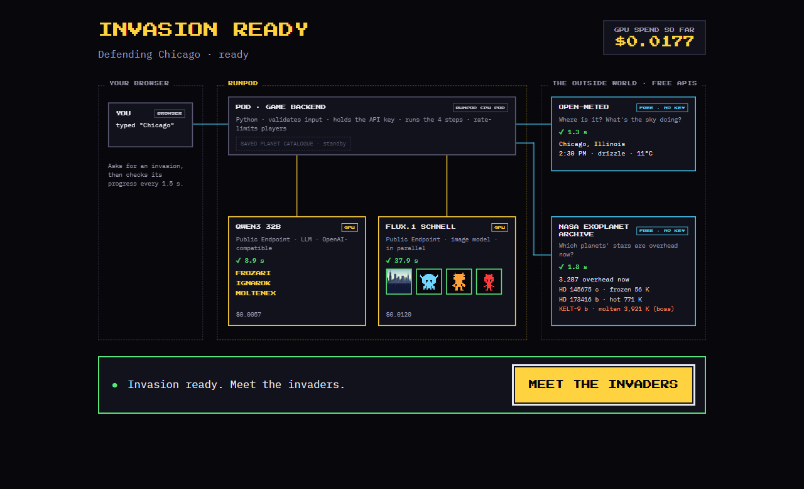
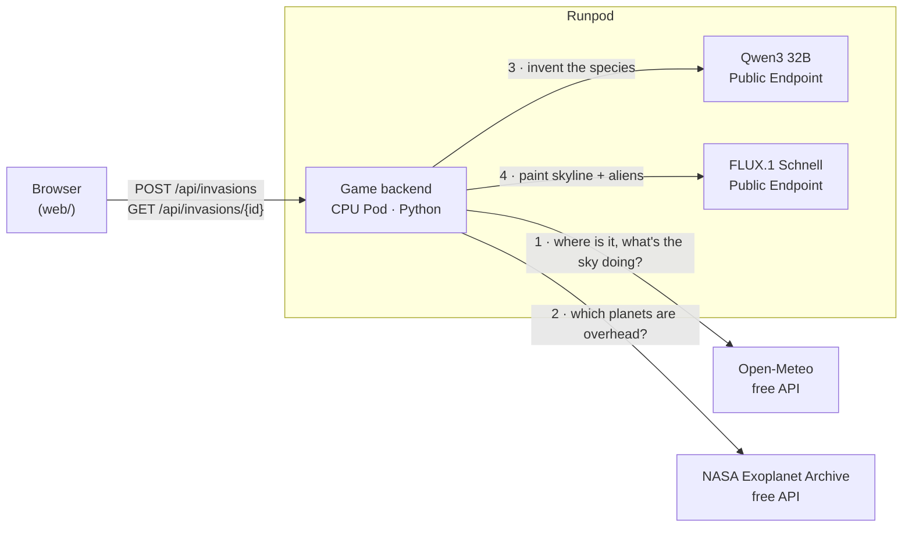

# Invasion Forecast

A retro arcade shooter where aliens invade **your city** from **real planets whose stars are overhead it right now**.

Type a city. The game reads its live weather, asks NASA which known exoplanets are above it, has an LLM invent an
alien species for each planet, and paints the skyline and every alien on a GPU. Then you defend it: three waves, the
last one a boss.

It's a small, complete example of building on [Runpod](https://www.runpod.io/): a web app hosted on a Runpod Pod
that combines two free public APIs with two AI models on Runpod Public Endpoints.

**Play it:** [live on Runpod](https://jom4ayqem6e6b1-8000.proxy.runpod.net) · **Watch it build:** the loading screen
is a live map of every request.



## How it works



One request, four steps. All of them live in [`app/invasion.py`](app/invasion.py), top to bottom:

| Step | Service | What it does | If it fails |
|---|---|---|---|
| 1. Sky | **Open-Meteo** (free) | Finds the city, and reads its weather and day or night right now | The game can't start: a clear error and a retry button |
| 2. Planets | **NASA Exoplanet Archive** (free) | Works out which patch of sky is overhead from the city's position and the exact time, then asks NASA which planets orbit stars in it | Uses the saved catalogue in the repo; same maths, same game |
| 3. Species | **Qwen3 32B** on Runpod | Invents a species for each planet (name, shape, bio) from its real data | Retries once, then uses built-in descriptions |
| 4. Art | **FLUX.1 Schnell** on Runpod | Paints the city's skyline in its current weather, and each alien as a pixel-art stencil | Anything not painted within 60 s becomes a silhouette |

The planet data drives the game: the coldest, middle and hottest planets become the three waves (the hottest is the
boss). Planet size sets how many hits an alien takes, its year length sets how fast it marches, and its temperature
sets its colour. The weather from step 1 is painted into the skyline and animated in the game.

**The Runpod part is one file:** [`app/runpod_ai.py`](app/runpod_ai.py) calls the LLM (it speaks the OpenAI API) and
the image model (with polling), in under 100 lines you can copy into your own project.

## Run it locally

You need Python 3.13+ (or Docker) and a [Runpod API key](https://console.runpod.io/user/settings).

```bash
git clone https://github.com/rhedgpeth/invasion-forecast && cd invasion-forecast
python -m venv .venv
source .venv/bin/activate                    # Windows: .venv\Scripts\activate
pip install -r requirements-dev.txt
cp .env.example .env                         # Windows: copy .env.example .env   (then put your key in .env)

uvicorn app.main:app --env-file .env         # → http://127.0.0.1:8000
```

Or with Docker, exactly as it runs on Runpod:

```bash
docker build -t invasion-forecast .
docker run --rm -p 8000:8000 --env-file .env invasion-forecast
```

Two saved invasions ship in [`packs/`](packs/), so the game is playable without a key or a network.

**Useful extras** (with the virtual environment activated)

- `python -m app Tokyo` prints the sky and the planets invading Tokyo right now. It's free: no Runpod calls.
- `python -m app Tokyo --save packs/tokyo-night` makes a full invasion and saves it as a pack (about 2 cents). It reads
  `RUNPOD_API_KEY` from your environment, not from `.env`, so set it first.
- `/?replay=tokyo-night` replays a saved invasion's loading map. It's a good demo backup if the GPU is slow.
- With `DEMO_FAULTS=1`, `/?simulate=gpu_down` (or `nasa_down`, `llm_down`, `weather_down`) shows each failure live.

**Tests** run offline with every external service faked, so they need no key and spend no credit:

```bash
pytest
```

## Configuration

| Variable | Default | What it does |
|---|---|---|
| `RUNPOD_API_KEY` | (required) | Calls the two Runpod Public Endpoints. Only the server ever sees it. |
| `MAX_GAMES_PER_DAY` | `200` | Games allowed per day across all players. Protects your credit. |
| `DEMO_FAULTS` | `0` | `1` enables `?simulate=…` for failure demos. |
| `DATA_DIR` | `data` | Where generated games are written. |

## Deploy to Runpod

The backend and the web page are one small container. It runs on a **CPU Pod**, because the GPU work happens on
Runpod Public Endpoints, so there's no GPU to rent for the server.

1. **Publish the image** (here to GitHub's container registry; make the package public so Runpod can pull it):
   ```bash
   docker build --platform linux/amd64 -t ghcr.io/<you>/invasion-forecast:1.0 .
   docker push ghcr.io/<you>/invasion-forecast:1.0
   ```
2. **Store your key as a Runpod secret.** In the console, go to **Secrets** and create one named
   `invasion_forecast_key`.
3. **Create a CPU Pod** from the image. The smallest Compute-Optimized one (2 vCPU, 4 GB) is plenty, at $0.06 an
   hour:
   - Expose HTTP port `8000`.
   - Set the environment variable `RUNPOD_API_KEY` to `{{ RUNPOD_SECRET_invasion_forecast_key }}`.
   - Optional: set `DEMO_FAULTS` to `1` to allow the `?simulate=` failure demos.
4. **Open** `https://<pod-id>-8000.proxy.runpod.net`.

To ship a change, build and push a new tag (for example `:1.1`), then point the Pod at it: **Edit Pod** → container
image in the console, or `PATCH https://rest.runpod.io/v1/pods/<pod-id>` with `{"imageName": "…:1.1"}`. The Pod
restarts with the new image and keeps its URL.

Prefer the API? The same Pod is one `POST https://rest.runpod.io/v1/pods` with `"computeType": "CPU"`,
`"imageName"`, `"ports": ["8000/http"]` and the `env` above.

Runpod's proxy closes requests after 100 s. A game takes 40–60 s to build, so the API never holds a request open
that long: the browser starts a job, then checks its progress every 1.5 s.

## Free tiers, costs and limits

| Service | Cost | Published limits | How the game stays inside them |
|---|---|---|---|
| [Open-Meteo](https://open-meteo.com/en/terms) | Free, no key; non-commercial use, CC BY 4.0 (credited in the game) | 600/min, 5,000/hour, 10,000/day | 2 calls per game; the daily game cap keeps it under 500 a day |
| [NASA Exoplanet Archive](https://exoplanetarchive.ipac.caltech.edu/docs/TAP/usingTAP.html) | Free, no key | None published | 1 small query per game, an 8 s timeout, and the saved catalogue as a fallback |
| Runpod Qwen3 32B | $10 per million tokens | Pay per use | About 800 tokens a game: under 1 cent |
| Runpod FLUX.1 Schnell | $0.003 per image (measured) | Pay per use | 4 images a game: about 1.2 cents |
| Runpod CPU Pod (hosting) | $0.06 an hour | — | About $1.44 a day while it's running |

A game costs about **2 cents** of Runpod credit. With the default cap of 200 games a day, the worst case is about $4 a
day of games, plus hosting.

## When things go wrong

**Rate limits**
- Each player can start one game every 20 seconds. Faster requests get `429` with `Retry-After`, and the button
  counts down.
- The player's address comes from `CF-Connecting-IP`, which Cloudflare (in front of Runpod's proxy) sets and
  clients can't forge. A forged `X-Forwarded-For` doesn't help.
- A game that fails before spending anything (an unknown city, say) doesn't count, so retrying works straight away.
- After `MAX_GAMES_PER_DAY` games, new games get `429` until midnight UTC.
- If Open-Meteo rate-limits us, the player sees a clear error and can retry. Its limits are far above what the cap
  allows.

**Outages:** every step has a planned fallback (see the table in [How it works](#how-it-works)), and the loading map
shows it happening. For example, when NASA doesn't answer, its wire turns red and the saved catalogue lights up.
This really happened while building the game: NASA's archive returned `503` for part of an afternoon.

**Timeouts:**
- 8 s for NASA.
- 90 s for an LLM call.
- 60 s for each round of painting (the skyline gets about 20 s more, since it starts first).

**Input:** city names are validated (letters in any language, 2–80 characters). Unknown cities get a friendly
"couldn't find" message.

**Secrets:** the Runpod key lives only in the server's environment (a Runpod secret in production) and never
reaches the browser.

## Project layout

```
app/
  invasion.py       ★ start here: the whole workflow, top to bottom
  sky.py            API 1: Open-Meteo
  planets.py        API 2: NASA Exoplanet Archive, plus the "which stars are overhead" maths
  runpod_ai.py      ★ the Runpod part: LLM + image model
  sprites.py        turns paintings into 16x16 arcade sprites
  rules.py          pure game rules: planet data → waves
  main.py           web routes, rate limits, error messages
web/                the game: plain HTML, CSS and JavaScript, with no build step
packs/              saved invasions: offline play and the demo backup
tests/              offline tests, including one per failure
docs/               Runpod docs feedback, screenshots
```

## Where this is going

Invasion Forecast is meant as the first game in a **Runpod Arcade**: one small game per Runpod choice, so developers
learn each one by playing it.

| Game | The Runpod choice it teaches |
|---|---|
| Invasion Forecast (this repo) | Public Endpoints: ready-made models, pay per call |
| A Serverless game | Serverless vs Pods: scale to zero, cold vs warm workers |
| A GPU-choice game | Picking a GPU: speed vs memory vs cost per run |
| A voice game | Other model types: speech in, speech out |

The first step is moving FLUX to a dedicated Runpod Serverless worker, for a faster, steadier wait.

## Known limitations

- **Games in progress live in memory.** A restart of the Pod drops games still being built (saved games are on disk).
- **One Pod, no autoscaling.** That's fine for a demo; heavy traffic would need Serverless or more Pods.
- **Painting time varies a lot** on the shared FLUX endpoint (25–60 s). Late images become silhouettes.
- **Keyboard only.** No touch controls yet.
- **The saved planet catalogue** is refreshed by hand (`python -m app.planets`).

## Suggested docs improvements

Building this turned up four small things a developer meets in their first hour with the image endpoint, such as the
image URL coming back in `output.result`. How the game handles each, and a doc change for each, are in
[docs/runpod-docs-feedback.md](docs/runpod-docs-feedback.md).

## How AI was used

- **Building it:** I built this with Claude Code (Anthropic) as a pair programmer. It helped brainstorm and
  stress-test the concept (I had it review the idea against the brief and rubric before building), and wrote code and
  tests at my direction. I made
  the design decisions, reviewed the work, and played and tested every step.
- **In the game:** an LLM (Qwen3 32B) writes the alien species, and an image model (FLUX.1 Schnell) paints the art,
  both on Runpod. The weather, the planets and the game rules are real data and plain code.

## Credits

- Weather data by [Open-Meteo.com](https://open-meteo.com/) (CC BY 4.0).
- Planet data from the [NASA Exoplanet Archive](https://exoplanetarchive.ipac.caltech.edu/), operated by Caltech
  under contract with NASA.

## License

[MIT](LICENSE)
